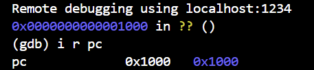
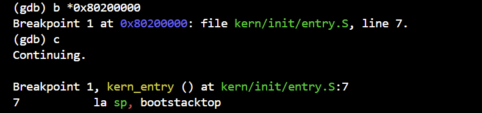
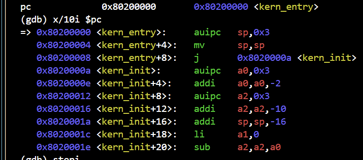
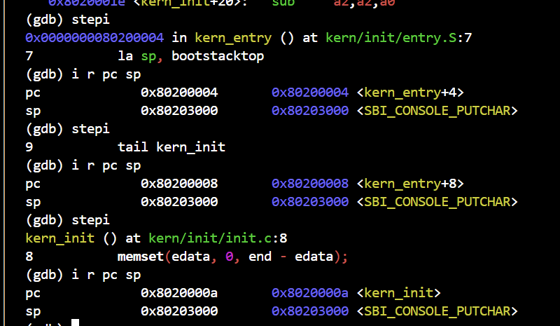
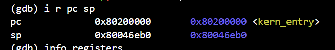
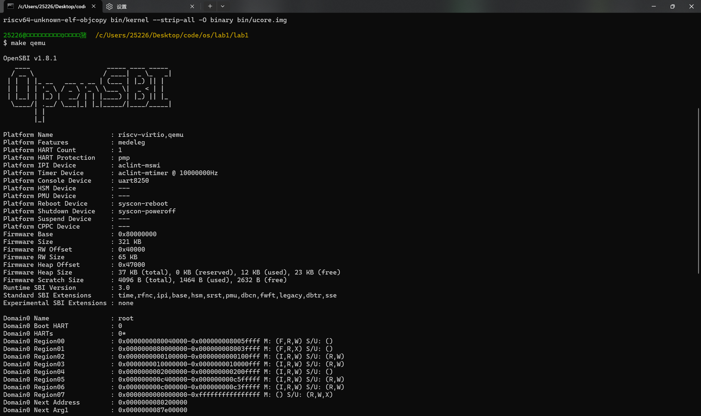
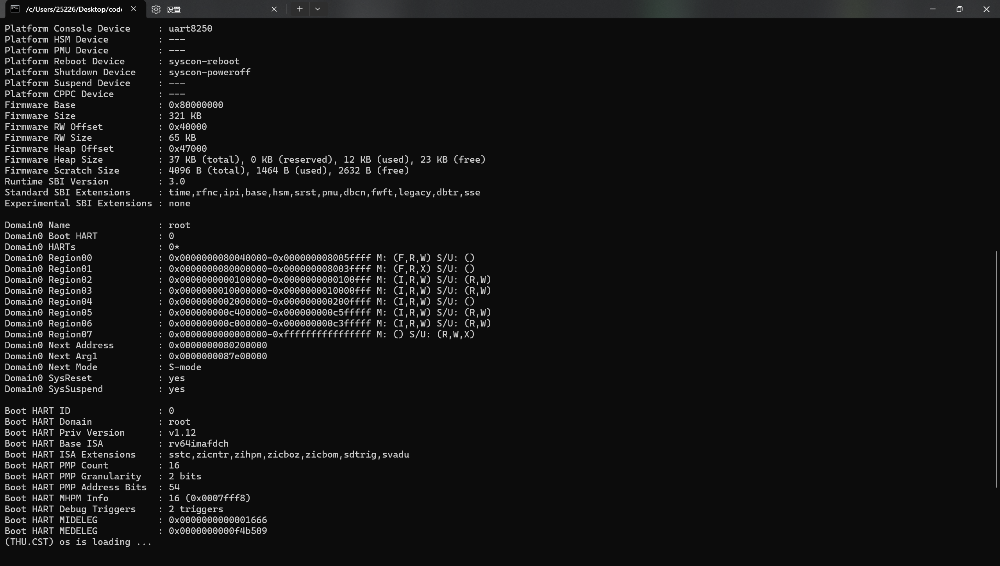

# 操作系统实验报告

## 实验基本信息

| 项目 | 内容 |
|------|------|
| **实验名称** | Lab 1: 最小可执行内核与启动流程 |
| **小组成员** | 2413329-殷彬淳、2411768-肖文哲、2412702-税思远 |
| **完成日期** | 2026-10-9 |

### 小组分工

**练习分工：**

| 成员 | 负责的练习/模块 |
|------|----------------|
| 2413329-殷彬淳 | 阶段1；练习2（GDB调试主导）；3.1 逻辑主线 |
| 2411768-肖文哲 | 阶段2；3.2 功能逐步实现；第六部分统稿 |
| 2412702-税思远 | 阶段3；练习1；第五部分测试截图 |

**实验报告分工：**

| 成员 | 负责的章节 |
|------|-----------|
| 2413329-殷彬淳 | 第三部分 3.1 逻辑主线；第四部分阶段1 |
| 2411768-肖文哲 | 第三部分 3.2 功能逐步实现；第四部分阶段2 |
| 2412702-税思远 | 第四部分阶段3；第五部分测试截图 |
| 全体 | 第六部分总结与收获 |

---

## 一、实验目的

本实验的主要目的是：

1. 理解操作系统内核在 QEMU 模拟的 RISC-V 计算机上从加电到启动的完整流程。
2. 掌握链接脚本、交叉编译、OpenSBI 引导、内核镜像加载等关键机制。
3. 学会通过 OpenSBI 提供的 SBI 服务实现内核态字符输出。
4. 学习使用 AI 辅助工具（Cline/Trae 等）分析代码、定位问题。

---

## 二、实验环境

| 成员 | AI 编程工具 | 底层模型 | 备注 |
|------|------------|---------|------|
| 2413329-殷彬淳 | Cline（VS Code 插件） | DeepSeek-V4-Pro | |
| 2411768-肖文哲 | VS Code / DeepSeek Harness | DeepSeek-V4-Flash | |
| 2412702-税思远 | Trae(AI IDE) / VS Code / SSH Remote | DeepSeek-V4-Pro | SSH 远程连接虚拟机/本机 |

**说明：**

- **AI 编程工具**：指具体使用的终端工具、编辑器插件、桌面应用或浏览器界面
- **底层模型**：指该工具使用的大语言模型及版本

---

## 三、实验整体逻辑分析

### 3.1 本章节的逻辑主线

**负责人：2413329-殷彬淳**

本章实验的核心主题是**最小可执行内核的启动流程**。整个实验解决的核心问题是：如何让一个操作系统内核在 QEMU 模拟的 RISC-V 计算机上从加电开始，经过固件引导，最终成功运行并输出字符。为此，实验按照硬件执行的自然顺序展开：首先由 QEMU 模拟加电复位，CPU 从固定复位地址 `0x1000` 开始执行 MROM 固件；随后控制权交给 OpenSBI，它在 M 模式下完成硬件初始化，并将编译好的内核镜像加载到物理地址 `0x80200000`；最后 CPU 跳转到该地址，执行内核入口 `kern_entry`，设置栈指针后进入 C 语言函数 `kern_init`，完成 BSS 段清零并输出 `(THU.CST) os is loading ...`。整个逻辑主线围绕"**固件 → 引导程序 → 操作系统**"的三级接力展开，每一步都为下一步准备好运行环境。

### 3.2 功能的逐步实现

**负责人：2411768-肖文哲**

本实验并不要求我们从零开始编写内核，而是要求我们看懂和跑通一个最小的可执行内核。整体上，本实验按执行流的先后顺序分三个阶段，这三个阶段的顺序是被硬件和特权级约束唯一确定的——每一阶段的输出都是下一阶段开始的前提。

1. **阶段1：硬件初始化和固件启动（MROM → OpenSBI）** → 为什么首先实现这个？

   在电脑开机和用操作系统来管理计算机这两个步骤之间，还需要一个"把操作系统加载到内存里"的步骤，而这个步骤不是操作系统自己能做到的，所以在操作系统执行之前需要一个其他程序（bootloader，在 QEMU 中为 OpenSBI）先完成"把操作系统加载到内存里"的工作。因此阶段1必须最先执行，因为只有阶段1最先执行才能让后面的阶段继续执行。

2. **阶段2：OpenSBI 初始化与内核加载** → 为什么接着实现这个？

   阶段1只解决了控制权应该交给 OpenSBI 的问题，但并没有解决"怎样把控制权交给 OpenSBI"的问题。M 模式是唯一能直接配置硬件的级别，所以 OpenSBI 的初始化必须在 M 模式下完成。内核镜像中的访存指令在编译链接时已经被确定为了绝对地址 `0x80200000`，因此内核必须放到这个地址上才能执行。阶段2完成了使 OpenSBI 成功运行初始化并将内核镜像加载到地址 `0x80200000` 的任务，为下一步内核执行做好铺垫。

3. **阶段3：内核启动执行（entry.S → kern_init）** → 为什么最后实现这个？

   阶段3的任务是阶段1和2的目标。C 函数的调用需要使用栈来保存返回地址，所以汇编入口先开辟了栈再将执行流交给 C 语言入口。最先清零 `.bss` 是因为未初始化的全局变量的初值需要清零。因为本实验的目标只是跑通最小内核，所以在调用输出函数后，因为没有任何进程和内存管理，所以进入死循环。

---

## 四、实验内容与实现

### 功能模块：阶段1 —— 硬件初始化和固件启动

**负责人：** 2413329-殷彬淳

#### 模块功能描述

本阶段是整个启动流程的起点。QEMU 模拟加电复位过程，CPU 的 PC 被硬件强制设置为复位地址 `0x1000`，从这里开始执行一小段写死的固件代码（MROM，Machine ROM）。MROM 的功能非常有限，主要完成最基本的硬件初始化，然后将控制权交给 OpenSBI。OpenSBI 被加载到物理内存 `0x80000000` 处，准备进行更复杂的初始化。

**关键流程：**

- QEMU 模拟加电复位，PC 被硬件强制设为 `0x1000`
- MROM 中的固件代码执行最基本的硬件初始化
- 控制权交给 OpenSBI（加载到 `0x80000000`）

#### 最终提示词

本阶段为硬件行为，不涉及代码生成，因此没有 AI 提示词。

#### 实现迭代过程

本阶段不涉及代码修改，无需迭代过程。我们通过阅读实验文档、结合 AI 解释，理解了 QEMU 复位向量、MROM 作用以及 OpenSBI 的加载地址。AI 帮助澄清了"为什么复位地址是 0x1000"以及"MROM 与 OpenSBI 的分工"，这些解释与后续 GDB 观察到的 PC 变化一致。

---

### 功能模块：阶段2 —— OpenSBI 初始化与内核加载

**负责人：** 2411768-肖文哲

#### 模块功能描述

这一阶段是启动执行流的中间环节，接住了阶段1中 MROM 运行结束后的控制权，将权限设置为 M 模式，使 OpenSBI 成功初始化，建立了内核运行的所有前置条件，最后把内核镜像放置到指定物理地址 `0x80200000` 并交出控制权，使下一步阶段3的内核能成功执行。

**关键流程：**

1. 进入 OpenSBI：CPU 跳转到 `0x80000000`，这是 QEMU 复位代码约定加载 bootloader 的位置，OpenSBI.bin 在这里开始执行
2. M 模式下初始化：OpenSBI 运行在 RISC-V 最高特权级 M 模式，因为固件需要直接访问硬件。OpenSBI 初始化了异常/中断委托、计时器、串口输出、内存保护和设备树信息，还划分了 Domain0 的运行区域
3. 确定内核的加载地址和入口地址：内核镜像在链接阶段就被固定在 `0x80200000`，`ENTRY(kern_entry)` 声明了 `kern_entry` 为程序入口，Makefile 的 `qemu` 把转换后的二进制镜像写入这一地址
4. 跳转并交出控制权：OpenSBI 初始化后，把执行权移交给内核，CPU 从 `0x80200000` 开始执行
5. 改变特权级：内核接下来在 S 模式下运行，OpenSBI 依然处于 M 模式

**涉及的代码/配置文件：**

| 文件位置 | 关键内容 | 在本模块中的作用 |
| ------------------- | ------------------------------------------------------------ | ------------------------------------------------------------ |
| `tools/kernel.ld` | `ENTRY(kern_entry)`<br />`BASE_ADDRESS = 0x80200000;`<br />`. = BASE_ADDRESS;`<br />`PROVIDE(etext = .);`<br />`PROVIDE(edata = .);`<br />`PROVIDE(end = .);` | 把内核镜像放在 `0x80200000`，使镜像最前端的 `.text` 位于 OpenSBI 要跳转的地址上 |
| Makefile | `qemu-system-riscv64 -machine virt -nographic -bios default -device loader,file=$(UCOREIMG),addr=0x80200000` | `-bios default` 使用 QEMU 内置的 OpenSBI；`-device loader` 把 `ucore.img` 写到物理地址 `0x80200000` |
| `kern/init/entry.S` | `kern_entry: la sp, bootstacktop` | 阶段3入口，验证控制权交接成功 |

#### 最终提示词

本实验没有需要 AI 生成的代码，任务为理解操作系统最小内核的启动过程并撰写实验报告，因此没有提示词。

---

### 功能模块：阶段3 —— 内核启动执行（entry.S 与 kern_init）

**负责人：** 2412702-税思远

#### 模块功能描述

**需要实现/修改的函数：**

```c
// 汇编入口：kern/init/entry.S
void kern_entry(void);          // 设置内核栈指针并跳转到 C 语言入口 kern_init

// C 语言入口：kern/init/init.c
int kern_init(void);            // 清理 BSS 段、调用 cprintf、输出启动信息后进入死循环
```

**功能说明：**

- **作用**：内核被 OpenSBI 加载到 `0x80200000` 后，从该地址开始执行的第一段代码就是本模块。它是整个操作系统内核的启动入口。
- **主要场景**：
  - OpenSBI 完成初始化后跳转到 `0x80200000`，进入 `kern_entry`。
  - `kern_entry` 通过 `la sp, bootstacktop` 把栈指针指向 `.data` 段中预留的内核栈，为后续 C 函数调用准备好栈空间。
  - 使用 `tail kern_init` 按照 RISC-V 调用约定（栈已就绪）跳转到 C 入口 `kern_init`。
  - `kern_init` 使用 `memset` 清零 BSS 段（`edata` 到 `end`），再调用 `cprintf` 输出 `(THU.CST) os is loading ...`，最后 `while(1);` 死循环（作为首个内核，暂无任务，故空转）。
- **与其他模块的交互**：本模块依赖前阶段（OpenSBI 加载定位到 `0x80200000`）与链接脚本（kernel.ld 以 `kern_entry` 为 `ENTRY` 且 `BASE_ADDRESS = 0x80200000`），输出依赖 `kern/driver/console.c` 与 `libs/printfmt.c` 提供的 `cprintf`。

#### 最终提示词

以下是经过迭代优化后，最终成功实现该功能的提示词：

```markdown
为 riscv64-ucore lab1 编写内核启动入口：
1. 在 kern/init/entry.S 用 .section .text 定义全局符号 kern_entry，通过 la sp, bootstacktop 设置栈指针，再用 tail kern_init 跳转到 C 函数。
2. 在 .data 段用 .space KSTACKSIZE 预留 bootstack，并定义 bootstacktop 指向栈顶。
3. 在 kern/init/init.c 实现 kern_init（声明为 noreturn）：先用 memset 清零 BSS 段，再调用 cprintf 输出字符串 (THU.CST) os is loading ...，最后进入 while(1) 死循环。
要求：保证 kern_entry 位于内核镜像最前，链接脚本 ENTRY 指向 kern_entry，基址为 0x80200000。
```

#### 实现迭代过程

本模块的实现经历了 2 次迭代，过程如下：

##### 第一次迭代

**遇到的问题：**

- 问题1：`make qemu` 无任何输出即"卡死"，屏幕上连 OpenSBI 信息都没有出现。原因分析：环境最初未正确设置（PATH 为空导致找不到 make；qemu 所需 OpenSBI 固件路径未配置），且早期通过 GUI 子系统版 qemu（`qemu-system-riscv64w.exe`）运行时，stdout 不会输出到交互终端。

**问题解决策略：**

- 针对问题1：补齐 `PATH` 与 `QEMU_BIOS` 环境变量，并将运行的 qemu 切换为控制台版本（不带 `w`），使输出能显示到终端。

##### 第二次迭代

**遇到的问题：**

- 问题1：`-bios default` 时 OpenSBI 显示的 `Domain0 Next Address` 为 `0x0000000000000000`，内核未被执行。原因分析：`-device loader` 只把镜像写入内存、未设置内核跳转入口。

**最终结果：**

经过 2 次迭代，该模块最终：

- ✅ 编译通过（`make` 产出 `bin/kernel` 与 `bin/ucore.img`）
- ✅ 运行验证通过：`make qemu` 后 OpenSBI 跳转到 `0x80200000`，终端输出 `(THU.CST) os is loading ...`
- ✅ 功能符合预期（内核启动入口工作正常）

**关键改进点总结：**

1. 明确使用 `-kernel` + 显式 `-bios` 固件路径，确保内核入口地址正确回填为 `0x80200000`。
2. 使用控制台版 qemu 与正确的环境变量，使输出可在终端显示。

---

### 练习1：理解内核启动中的程序入口操作

**负责人：** 2412702-税思远

阅读 `kern/init/entry.S` 内容代码，结合操作系统内核启动流程，说明指令 `la sp, bootstacktop` 完成了什么操作，目的是什么？`tail kern_init` 完成了什么操作，目的是什么？

**`la sp, bootstacktop` 的解答：**

- **完成了什么操作**：`la`（load address）是 RISC-V 的取地址伪指令，这里它把符号 `bootstacktop` 的地址装入栈指针寄存器 `sp`。`bootstacktop` 指向 `.data` 段中用 `.space KSTACKSIZE` 预留的内核栈 `bootstack` 的栈顶（栈内存是内核镜像的一部分，位于链接脚本基址 `0x80200000` 之上）。
- **目的**：为内核建立可用的初始栈。RISC-V 汇编约定下，C 函数调用会依赖栈来保存返回地址（`ra`）、局部变量与被调用者保存的寄存器。内核刚被 OpenSBI 跳转进来时栈指针没有有效值，若不显式设置到一块合法且已预留的内存上，后面调用 `kern_init` 前后任何函数使用栈都会访问到非法地址导致崩溃。因此第一步必须先让 `sp` 落在一块合法栈空间。
- **补充**：启动早期尚未启用虚拟地址翻译，内核使用的就是链接期确定的物理地址，所以这里用 `la` 伪指令取符号地址（会展开为 `auipc` + 立即数偏移指令），体现"栈建立在镜像内部、以链接期地址为准"。

**`tail kern_init` 的解答：**

- **完成了什么操作**：`tail` 是"尾调用"伪指令，它会展开为两步：先以 PC 相对寻址把 `kern_init` 的地址装入 `t1`，再用 `jalr x0, 0(t1)` 跳转过去。与普通 `call`（`jal ra, ...`）不同的是，`tail` 不把返回地址写入 `ra`，即跳转后不保留返回地址。
- **目的**：在栈已就绪的前提下把执行流交给 C 语言入口函数 `kern_init`。之所以用 `tail` 而非 `call`：`kern_entry` 完成后没有需要返回到的调用者，且 `kern_init` 末尾是 `while(1);` 死循环、本身不会返回，因此无需在 `ra` 中保存返回地址、也无须为新调用建立一个返回链。用尾调用的语义正好与"入口调用不再返回、之后无限循环空转"这一最小内核的形态相符，同时避免多余的栈帧开销。

---

### 练习2：使用GDB验证启动流程

**负责人：** 2413329-殷彬淳

请使用 GDB 跟踪 QEMU 模拟的 RISC-V 从加电开始，直到执行内核第一条指令（跳转到 0x80200000）的整个过程。通过调试，请思考并回答：RISC-V 硬件加电后最初执行的几条指令位于什么地址？它们主要完成了哪些功能？请简要记录你的调试过程、观察结果和问题的答案。

**调试过程：**

1. 在终端 1 启动 QEMU，使用 `-S -s` 参数让 CPU 暂停并等待 GDB 连接：

   ```bash
   qemu-system-riscv64 -nographic -machine virt -bios default -kernel bin/kernel -S -s
   ```

2. 在终端 2 使用 `gdb-multiarch` 连接 QEMU 的 1234 端口：

   ```bash
   gdb-multiarch -ex 'file bin/kernel' -ex 'set arch riscv:rv64' -ex 'target remote localhost:1234'
   ```

3. GDB 连接后停在 `0x1000`，这是 QEMU 的复位地址。执行 `i r pc` 确认 PC 值，并设置断点到内核入口：

   ```gdb
   i r pc
   b *0x80200000
   c
   ```

   断点命中后，GDB 显示：

   ```
   Breakpoint 1, kern_entry () at kern/init/entry.S:7
   7           la sp, bootstacktop
   ```

**观察结果：**

- **GDB 初始连接**：PC = `0x1000`，即 QEMU 复位向量地址。

  

- **断点命中**：在 GDB 中执行 b *0x80200000 设置断点，然后 c 继续执行。断点命中后 GDB 显示停在 kern_entry 函数，对应 kern/init/entry.S:7 的 la sp, bootstacktop 指令。

  

- **反汇编 `x/10i $pc`**：显示 `entry.S` 编译后的指令，`la sp, bootstacktop` 展开为 `auipc sp,0x3` 等，`tail kern_init` 展开为 `j 0x8020000a <kern_init>`。

  

- **单步执行**：连续三次 `stepi` 并观察 PC/SP 变化：

  | 步骤 | PC | SP | 说明 |
  |------|-----|-----|------|
  | 断点命中 | `0x80200000` | `0x80046eb0` | 刚进入 `kern_entry` |
  | 第 1 次 `stepi` | `0x80200004` | `0x80203000` | `la sp, bootstacktop` 执行完，SP 被设为内核栈顶 |
  | 第 2 次 `stepi` | `0x80200008` | `0x80203000` | `tail kern_init` 准备跳转 |
  | 第 3 次 `stepi` | `0x8020000a` | `0x80203000` | 进入 `kern_init`，执行 `memset` |

  

- **断点命中时的寄存器**：`i r pc sp` 显示 PC = `0x80200000`，SP = `0x80046eb0`。

  

**问题回答：**

**RISC-V 硬件加电后最初执行的几条指令位于什么地址？**

位于 `0x1000`。这是 QEMU 模拟的 RISC-V 处理器的复位向量地址，CPU 上电后 PC 被硬件强制设为该值，从这里开始执行 MROM 中的固件代码。

**它们主要完成了哪些功能？**

1. **MROM 阶段（`0x1000`）**：执行最基础的硬件初始化，将 OpenSBI 固件加载到 `0x80000000` 并跳转。
2. **OpenSBI 阶段（`0x80000000`）**：运行在 M 模式，初始化处理器运行环境（中断委托、PMP 配置、时钟、串口等），将内核镜像加载到 `0x80200000`，最后跳转并移交控制权给内核。
3. **内核阶段（`0x80200000`）**：执行 `kern_entry`，设置内核栈指针 `sp`，跳转到 `kern_init`，开始 C 语言内核初始化。

---

## 五、测试与验证

**负责人：** 2412702-税思远

**测试截图：**

编译成功并执行 `make qemu`，OpenSBI 启动：



内核启动成功，输出 `(THU.CST) os is loading ...`：



---

## 六、实验总结与收获

### 对操作系统的理解

**负责人：全体成员**

1. 列出你们认为本实验中重要的知识点，以及与对应的 OS 原理中的知识点，并简要说明二者的含义、关系和差异

| 实验知识点 | OS原理对应 | 含义 | 关系与差异 |
|-----------|-----------|------|-----------|
| 链接脚本指定加载地址 | 程序内存布局 | 链接脚本（kernel.ld）通过 `BASE_ADDRESS=0x80200000` 决定内核镜像各段加载到内存的物理地址，并 `ENTRY(kern_entry)` 指定入口。 | 都解决"程序代码与数据放在内存哪里"的问题；但实验处于无 OS 的裸机期，依赖链接脚本静态固定地址，而 OS 原理中由加载器/动态链接在运行时安排布局，粒度更动态抽象。 |
| SBI 调用（ecall） | 系统调用 | 内核在 S 模式通过 `ecall` 陷入转移到 M 模式的 OpenSBI，请求串口输出等服务。 | 二者都是"通过陷入切换到更高特权级服务方来请求受保护服务"的机制；差异在调用方层级：实验是内核请求固件（S→M），原理是用户进程请求内核（U→S）。 |
| 内核栈设置 | 进程栈管理 | entry.S 用 `la sp, bootstacktop` 把栈指针指向镜像内预留的 bootstack，为函数调用建立初始栈。 | 本质都是"运行代码必须有合法栈空间"；实验只建立了一个全局固定的引导栈，而原理中每个进程拥有独立栈、进程切换时同步切换栈指针，管理粒度和动态性更强。 |
| 特权级切换 | 用户态/内核态 | OpenSBI 在最高特权级 M 模式完成初始化后，把控制权交给运行在 S 模式的内核。 | 体现了 M/S 特权级与"固件/OS"分层；原理中的用户态/内核态隔离是 U/S 两态，实验描述的是更偏底层的 S/M 固件与 OS 的关系，二者共享"用特权级隔离不同层级代码"的思想。 |

2. 列出你们认为 OS 原理中很重要、但在本实验中没有对应上的知识点

- 进程/线程调度：本实验只有一个永不退出的死循环内核，没有多进程，因此无调度算法。
- 虚拟内存与分页（MMU 页表翻译）：本实验内核直接运行在物理地址 `0x80200000` 上，未配置分页与地址重映射。
- 文件系统：本实验无磁盘、无文件抽象，仅靠串口输出。
- 并发与同步：无多核/多进程共享资源，因此没有锁、信号量等同步机制。
- 完整的中断/异常处理机制：本实验仅借 OpenSBI 提供串口等服务，未深入设备中断控制器与自定义异常向量表。

### AI 协作开发的经验

**负责人：全体成员**

- **用"看代码"的任务里把 AI 当解释器而非写码机**：本实验是理解最小内核，不在 AI 生成代码，因此我们让 AI 逐行讲解 entry.S、kernel.ld、Makefile，把 `la sp`、`tail`、`BASE_ADDRESS`、`-device loader` 等写成"为什么这样"的解释，帮助快速建立启动流程的整体认识，收益比直接贴代码更大。
- **以迭代式、阶段化的提示词推进**：把大目标拆成"阶段1/阶段2/阶段3+练习"独立提问，每个阶段让 AI 聚焦单个子问题（为何要 M 模式、为何内核固定 0x80200000、为何清零 BSS 等），提示更精准，也便于按成员分工。
- **AI 输出必须与真实启动流程交叉校验**：AI 可能给出"听起来合理"但错位的解释。我们通过 GDB 跟踪 0x1000 → 0x80000000（MROM→OpenSBI） → 0x80200000（内核） 的 PC 变化，以及 `make qemu` 的实际输出，反向核对 AI 结论，避免被臆造内容带偏。
- **环境问题交给 AI 定位、由人工确认**：阶段3遇到的"make qemu 无输出/OpenSBI 不跳转内核"，用 AI 的提示补全 PATH、`QEMU_BIOS`、切换控制台版 qemu，并由成员实际复跑确认，形成"AI 给排查思路 + 成员验证落地"的协作闭环。

---