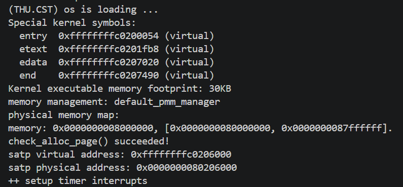
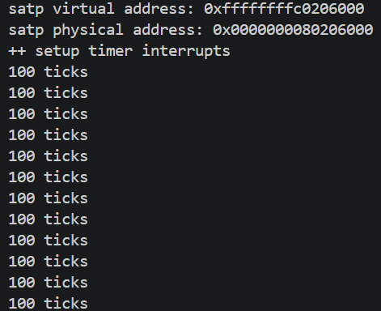
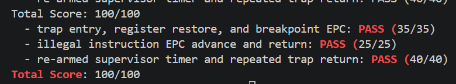
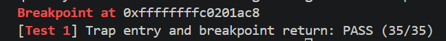
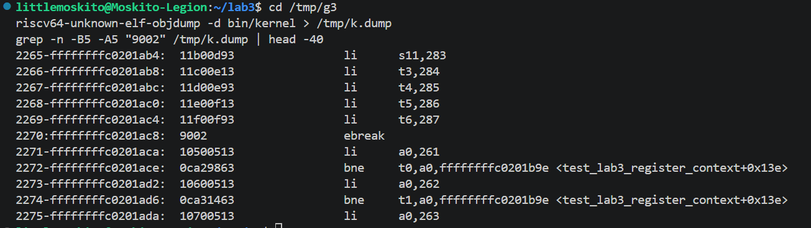
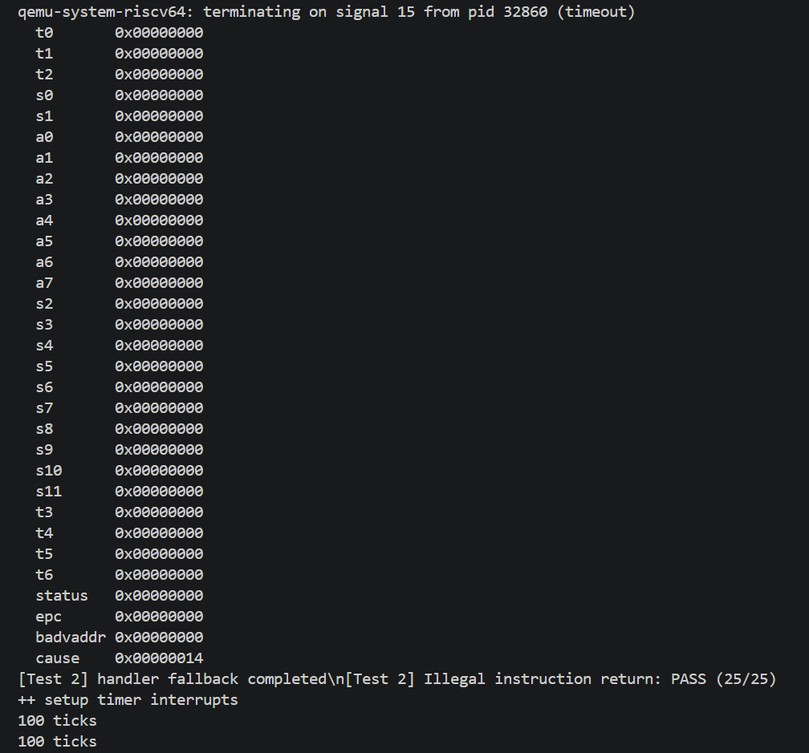
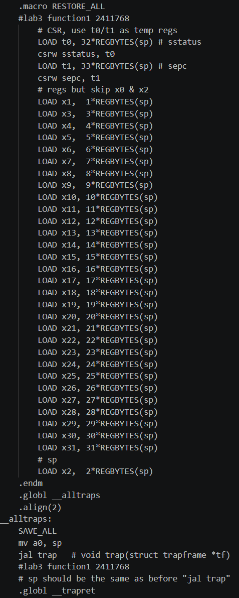

# 操作系统实验报告 - Lab3: 中断与异常处理

## 实验基本信息
| 项目 | 内容 |
|------|------|
| **实验名称** | Lab 3: 中断与异常处理 |
| **小组成员** | 肖文哲、税思远、殷彬淳 |
| **完成日期** | 2026-11-08 |

### 小组分工
| 成员 | 负责的模块/任务 | 负责的报告章节 |
|------|----------------|--------------|
| 肖文哲 | `trapentry.S`（`RESTORE_ALL`、`__alltraps`）；Trap 上下文闭环验证 | 模块一、Trap 上下文 Prompt/Bug、GDB 寄存器验证截图 |
| 税思远 | `trap.c`（`interrupt_handler`、`exception_handler`）；时钟中断计数与关机逻辑 | 模块二、中断/异常 Prompt/Bug、`make qemu` 输出分析 |
| 殷彬淳 | 同步机制（`local_intr_save/restore`、原子操作思考）；报告统稿与 `YOUR CODE` 学号替换检查 | 整体逻辑、同步机制思考题、OS 原理对比、统稿 |

---

## 一、实验目的
理解 RISC-V 架构下的 Trap（中断与异常）机制；掌握 Trap frame 的保存/恢复与 C 语言处理函数的调用约定；实现时钟中断、非法指令异常、断点异常的基本处理；理解临界区与开关中断的同步思想，为后续的进程调度与并发打下基础。

## 二、实验环境
| 成员 | AI 编程工具 | 底层模型 |
|------|------------|---------|
| 肖文哲 | VS Code / DeepSeek Harness | DeepSeek-V4-Flash |
| 税思远 | Trae(AI IDE) / VS Code / SSH Remote | DeepSeek-V4-Pro |
| 殷彬淳 | Cline（VS Code 插件） | DeepSeek-V4-Pro |

---

## 三、实验整体逻辑分析
**负责人：殷彬淳**

本章按照 **“Trap 入口与上下文保存/恢复 → C 语言分发与具体处理 → 同步与原子性保障”** 的顺序展开：
1. **底层闭环**：`SAVE_ALL` 在汇编层保存现场 → `__alltraps` 将当前 `trapframe` 的地址作为第一个参数（`a0`）传给 C 语言 `trap()` → C 语言按 `cause` 分发处理 → `__trapret` 调用 `RESTORE_ALL` 恢复现场 → `sret` 返回原执行流。
2. **分类处理**：`trap_dispatch()` 根据 `cause` 分流到 `interrupt_handler()` 或 `exception_handler()`；时钟中断需持续设置下一次事件，异常需正确更新 `epc` 避免死循环。
3. **原子性保障**：在修改内存管理数据结构等临界区时，使用 `local_intr_save/restore` 临时屏蔽/恢复中断，防止并发打断导致链表断裂。

---

## 四、实验内容与实现

### 1. Trap 上下文恢复与入口（`trapentry.S`）
**负责人：肖文哲**

**核心函数**：`RESTORE_ALL`、`__alltraps`

**功能说明**：**trapframe 的 36 格布局（`kern/trap/trap.h`，8 字节一格）**：

| 槽位  | 内容                                       | 槽位 | 内容       |
| ----- | ------------------------------------------ | ---- | ---------- |
| 0     | x0 zero                                    | 32   | `sstatus`  |
| 1     | x1 ra                                      | 33   | `sepc`     |
| **2** | **x2 sp（被打断那一刻的 sp）**             | 34   | `sbadaddr` |
| 3–31  | gp, tp, t0–t2, s0–s1, a0–a7, s2–s11, t3–t6 | 35   | `scause`   |

`RESTORE_ALL` 的三个关键点：

1. **`sp` 不在常规位置。** `SAVE_ALL` 开头先 `csrw sscratch, sp` 把原 sp 存进 CSR，减完 288 字节后才用 `csrrw s0, sscratch, x0` 把它取回来写进第 2 槽。所以第 2 槽不是"`sp-16` 那种常规偏移"，而是**原 sp 的值**。
2. **`sp` 必须最后恢复。** 一开始我想用 `addi sp, sp, 288` 收栈，但这样得到的是"trapframe 顶部的地址"，不是被打断时的 sp。正确做法是从第 2 槽读回来：`LOAD x2, 2*REGBYTES(sp)`。这条指令以 `sp` 为基址又写 `sp`，在 RISC-V 里读到的是"执行这条指令之前"的 sp（仍指向 frame 底部），所以放在最后一条正好。
3. **32–35 槽是 CSR，不是普通寄存器。** 恢复时对 `sstatus`、`sepc` 用 `csrw`；而 `sbadaddr`、`scause` 是**只读**的，写回去会触发非法指令，所以只恢复前两个。

**`__alltraps` 的返回值去哪了**：

`jal trap` 之前 `a0 = sp`（即 trapframe 的地址），这满足 RISC-V 调用约定（第一个参数走 `a0`）。`trap()` 返回后 **PC 自然落到下一条指令**，而 `__trapret:` 就紧跟在 `jal trap` 之后，所以不需要额外 `j __trapret`；随后 `RESTORE_ALL` + `sret` 完成返回。整个闭环是：`SAVE_ALL`（存 36 格）→ `a0 = sp` → `jal trap` → C 里改 `tf`（如推进 `epc`）→ `RESTORE_ALL`（读 36 格）→ `sret`（按 `sepc` 返回、按 `SPP` 定特权级）

**官方 spec 与我提炼的约束**：

| 官方 spec 原文要求                                          | 提炼出的可执行约束                        | prompt 第几条 |
| ----------------------------------------------------------- | ----------------------------------------- | ------------- |
| "根据 SAVE_ALL 已有的保存关系设计 RESTORE_ALL"              | 不许自己假设布局，逐槽对照 36 格          | 第 1 条       |
| "特别注意 SAVE_ALL 对 `x2(sp)` 的处理与其他寄存器不同"      | 原 sp 在 `2*REGBYTES(sp)`，且必须最后恢复 | 第 3 条       |
| "`__alltraps` 按 RISC-V 调用约定把 trapframe 传给 `trap()`" | 第一个参数走 `a0`：`mv a0, sp`            | 第 2 条       |
| "`trap()` 返回后应进入 `__trapret`"                         | `jal trap` 之后顺序落下去，不用额外跳     | 第 2 条       |
| "不得修改 SAVE_ALL、struct trapframe、`trap()` 签名"        | 只动两处 `YOUR CODE`                      | 第 4 条       |

**Prompt 的迭代**：

第一版只写了"补全 RESTORE_ALL 和 `__alltraps`，与 SAVE_ALL 对称"，生成结果直接把 `sp` 当普通寄存器处理，还多写了一条 `addi sp, sp, 288` 收栈。问题在于：**"对称"这个词太抽象**，模型并不知道 `x2` 被特殊处理过。

第二版把不可见的约束**显式写成可验证的句子**：
① 贴出 36 格布局，说清第 2 槽存的是原 sp；
② 明确要求"`sp` 必须最后恢复，且只能用 `LOAD x2, 2*REGBYTES(sp)`，不能 `addi` 收栈"；
③ 明确"`a0` 放 trapframe 地址，`jal trap` 后顺序落到 `__trapret`"；
④ 明确禁止改 SAVE_ALL 和函数签名。生成结果一次通过。

**Prompt 设计**：

```markdown
【prompt】
在 RISC-V 64 位 ucore 内核的 kern/trap/trapentry.S 中，补全 RESTORE_ALL 和 __alltraps。
约束：
1. 必须严格对应已有的 SAVE_ALL 的保存顺序和 struct trapframe 布局。
2. __alltraps 需要把当前 trapframe 的地址按 RISC-V 调用约定放入 a0，然后 call trap；trap 返回后进入 __trapret。
3. RESTORE_ALL 恢复寄存器时，x2(sp) 不能像普通寄存器一样直接 pop，需要依据 SAVE_ALL 中 x2 的保存方式正确处理。
4. 不得修改 SAVE_ALL、struct trapframe 或 trap() 的函数签名。
```

**Bug 与解决**：

**Bug 1（启动）：`make qemu` 只打印 OpenSBI 横幅，之后彻底没有输出**

- 现象：能看见 `Domain0 Next Address: 0x0000000080200000`、`MIDELEG 0x1666`、`MEDELEG 0xf4b509`，但连 `(THU.CST) os is loading ...` 都不出现，用 `-kernel` 直接启动也一样。
- 定位：`qemu-system-riscv64 ... -d in_asm,guest_errors -D /tmp/q.log` 打开指令追踪，日志里最后一条永远是 `0x80200034: csrrw zero,satp,t0`——正好是打开 Sv39 分页的那一条，之后没有任何新指令块，也没有 OpenSBI 的 unhandled trap 输出。
- 根因：骨架 `kern/init/entry.S` 的 `boot_page_table_sv39` 只映射了高地址`0xFFFFFFFFC0000000`（第 511 项），**没有映射物理地址 `0x80000000` 所在的那 1G**。`csrw satp` 生效的一瞬间 PC 还在物理地址 `0x8020_00xx`，下一条 `sfence.vma` 取指要翻译`0x80200038`，对应 PTE 为 0 → 取指缺页；该异常没有委托给 S 态，于是静默卡死。
- 解决：在页表里补第 2 项恒等映射 `.quad (0x80000 << 10) | 0xcf`（1G@0x80000000），使总项数为 512。修复后正常打印 `(THU.CST) os is loading ...`。
- 验证：`xxd -s 0x5010 -l 8 bin/ucore.img` 与 `xxd -s 0x5ff8 -l 8 bin/ucore.img`都应输出 `cf 00 00 20 00 00 00 00`（页表在镜像偏移 0x5000）。

**Bug 2（上下文闭环）：Test 1 一直 `FAIL (register context)`，但 trapframe 每一格都对**

- 现象：`[Test 1] Trap entry and breakpoint return: FAIL (register context)`，直接丢 35 分。但在断点分支里临时加 `print_trapframe(tf)` 打出来看，`t0=0x105`、`t1=0x106` … `s0=0x108`、`a1=0x10b` … `t6=0x11f` **全部正确**；`objdump -d` 出来的 `__trapret` 机器码也逐条正确（30 条 `ld` + `ld sp,16(sp)` + `sret`）。
- 定位：现场对、恢复代码对，那问题只可能在"返回到哪一条"。查断点地址 `0xffffffffc0201aa8` 发现 `ebreak` 被汇编器压成了 **2 字节的 `c.ebreak`（机器码 `0x9002`）**，因为它后面紧跟的 `li a0, 0x105` 处在 4 字节对齐位置。而 `exception_handler` 里写的是 `tf->epc += 4`，于是返回地址落到 `0x...1aac`——**正好是 `li a0, 0x105`（`0x10500513`，4 字节 `addi`）的中间**，这条指令被整体跳过，`a0` 保持断点时刻的旧值 `0x53`，比较链第一条 `bne t0, a0` 立刻失败。
- 解决：按 RISC-V 编码规则判断长度，低 2 位是 `11` 才是 32 位指令：
  ```c
  static uintptr_t insn_length(uintptr_t epc) {
      uint16_t insn = *(volatile uint16_t *)epc;
      return ((insn & 0x3) == 0x3) ? 4 : 2;
  }
  ```
  
  非法指令与断点两个分支都改成 tf->epc += insn_length(tf->epc);。

结论："异常统一 epc += 4"是错的——RISC-V 有 RVC 压缩指令，指令长度可变。 这一条也说明：光看"我自己写的代码对不对"不够，必须把"硬件实际给的 epc" 和"返回后的下一条指令"一起对，才能定位到是长度判断而不是寄存器恢复的问题。

---

### 2. 中断与异常处理（`trap.c`）
**负责人：税思远**

**核心函数**：`interrupt_handler()`、`exception_handler()`

**功能说明**：
- **`interrupt_handler`**：处理 `IRQ_S_TIMER`（时钟中断）。每次必须调用 `clock_set_next_event()` 设置下一次时钟事件；`ticks++`；每 `TICK_NUM` 次输出统计信息；累计输出达到 `SHUTDOWN_AFTER` 后调用 SBI 关机接口。其他中断做基本区分与提示。
- **`exception_handler`**：处理 `CAUSE_ILLEGAL_INSTRUCTION`（非法指令）和 `CAUSE_BREAKPOINT`（断点）。按规定格式输出信息；**根据指令编码规则判断长度（2 字节或 4 字节）并正确更新 `tf->epc`**，避免返回后死循环。未列出的异常使用 `print_trapframe(tf)` 兜底。

**Prompt 设计**：
```markdown
【prompt】
在 kern/trap/trap.c 中实现 interrupt_handler 和 exception_handler。
要求：
1. 时钟中断：每次必须调用 clock_set_next_event()；ticks 累加；每 TICK_NUM 输出统计；达到 SHUTDOWN_AFTER 后关机。
2. 非法指令/断点异常：输出规定格式；根据指令是否为压缩指令（低 2 位是否为 11）决定 epc 偏移是 2 还是 4。
3. 其他中断/异常：做基本提示或调用 print_trapframe(tf)。
4. 不得修改函数签名和 trap_dispatch() 等已有框架代码。
```

**Bug 与解决**：
- **Bug 1**：时钟中断打印一次后就再也不触发了。
- **解决**：在 `interrupt_handler` 开头漏掉了 `clock_set_next_event()`，导致硬件定时器没有被重新装载。补上后中断持续触发。
- **Bug 2**：断点异常触发后，返回执行又触发同一断点，陷入死循环。
- **解决**：最初更新 `epc` 时直接 `tf->epc += 4`。后来判断指令低 2 位，如果是 16 位压缩指令则 `+= 2`，否则 `+= 4`，死循环解决。

---

### 3. 同步机制与原子性（思考/辅助任务）
**负责人：殷彬淳**

**核心内容**：
- **`do { ... } while (0)` 的作用**：将多行代码包裹成一个逻辑块，保证宏展开后，在 `if/else` 分支中不会因为分号截断而导致语法错误（例如悬挂 `else` 问题）。
- **关中断的意义**：`alloc_pages` / `free_pages` 会遍历并修改空闲块双向链表。如果在遍历过程中发生时钟中断，且中断处理程序恰好也触发了内存分配，会导致链表指针被破坏。单核环境下，通过 `local_intr_save` 屏蔽中断，操作完成后再 `local_intr_restore` 恢复原状态，是保护临界区最简单有效的手段。

---

## 五、测试与验证
**负责人：肖文哲 / 税思远（联合）**

环境：WSL2 Ubuntu、`riscv64-unknown-elf-gcc 10.2.0`、QEMU `10.2.1`。

> **对 `tools/grade.sh` 的改动说明**：本机 QEMU 10.2.1 上
> `-device loader,file=bin/ucore.img,addr=0x80200000` 无法让内核启动（只打印 OpenSBI 横幅），
> 因此把启动方式改为 `-kernel bin/ucore.img`，`-nographic` 换成 `-display none`
> （避免接管终端导致 Ctrl+C 失效），并给 `timeout` 加 `-k 2`。
> 改动只影响"怎么启动 QEMU"，不涉及任何判分逻辑与 grep 判据。

### 5.1 启动与时钟中断





`print_ticks()` 打印的是常量 `TICK_NUM`（值为 100），所以**每一行都是 `100 ticks`**，
行数才代表流逝的时间（10 ms × 100 = 1 秒一行）。

### 5.2 自动判分



| 用例   | 分值 | 验证目标                                                     | 关键输出                                                     |
| ------ | ---- | ------------------------------------------------------------ | ------------------------------------------------------------ |
| Test 1 | 35   | Trap 入口、26 个通用寄存器原样恢复、断点后 `epc` 正确推进    | `Breakpoint at 0xffffffffc0201ac8`                           |
| Test 2 | 25   | 非法指令后能返回；`interrupt_handler` 剥掉 `cause` 最高位；未知 `cause` 走兜底 | `Illegal instruction at`、`Supervisor software interrupt`、`Unknown interrupt: cause 15`、`cause    0x00000014` |
| Test 3 | 40   | 时钟中断**持续**触发，`ticks` 能到 200                       | 每行 `100 ticks`、`ticks=200`                                |

### 5.3 上下文闭环验证（模块一）





三张图可以互相印证：`test1_pass.png` 里的断点地址 `0xffffffffc0201ac8`，
正是 `objdump` 里 `1ac8: 9002 ebreak` 的位置；而它后面 `1aca: 10500513 li a0,261`
只隔 2 字节，所以"`epc += 4`"会正好落在这条 `addi` 的中间——这就是 Test 1 一开始
`FAIL (register context)` 的原因。反汇编器把它显示成 `ebreak`，但机器码 `9002`
和地址差 `1aca - 1ac8 = 2` 共同说明它是 2 字节压缩指令。

### 5.4 异常处理验证（模块二）



### 5.5 代码与学号注释



两处 `#lab3 function1` 注释均保留，`YOUR CODE` 已替换为学号 `2411768`。

---

## 六、实验总结与收获
**负责人：税思远（主导），全体补充**

### 1. 知识点与 OS 原理对比
| 实验知识点 | OS 原理对应 | 关系与差异 |
|-----------|-----------|-----------|
| Trap frame 保存/恢复与 `sret` | 中断/异常上下文切换 | 原理一致：保存现场→处理→恢复→返回。实验要求在汇编层手动完成，原理课更侧重于理论抽象。 |
| 时钟中断与 `clock_set_next_event` | 硬件定时器与抢占式调度基础 | 实验只做了计数，未引入进程调度。原理中时钟中断是操作系统抢占式调度的“心跳”。 |
| `tf->epc` 更新与指令长度 | 异常返回地址修正 | 实验要求严格区分 16 位压缩与 32 位非压缩指令；原理中由硬件或内核统一处理，不同指令集架构有不同细节。 |
| `local_intr_save/restore` | 临界区与关中断 | 单核环境下关中断是实现原子性的基础手段；原理中还会涉及自旋锁、信号量等多核同步机制。 |

### 2. OS 原理中重要但实验未覆盖的知识点
- **中断嵌套与优先级**：实验未涉及中断嵌套处理，而真实 OS 中高优先级中断可打断低优先级中断。
- **多核 IPI（处理器间中断）**：实验基于单核，未触及多核并发场景下的同步与 TLB Shootdown。
- **系统调用**：实验聚焦硬件中断与异常，未深入从 U 模式到 S 模式的系统调用路径。

### 3. AI 协作开发经验与 Prompt 汇总
- **汇编约束极强**：AI 很容易忽略 `SAVE_ALL` 与 `RESTORE_ALL` 的严格对称性，尤其是 `sp` 的特殊性。必须在 Prompt 中**显式强调“参考已有保存顺序，不要自行假设布局”**。
- **边界条件**：AI 生成异常处理时，可能默认所有异常 `epc += 4`。需要在 Prompt 中明确要求“检查指令低 2 位，区分压缩指令”。
- **验证驱动**：对于中断处理，要求“时钟中断持续触发”是验证 `clock_set_next_event` 是否遗漏的最直接标准。